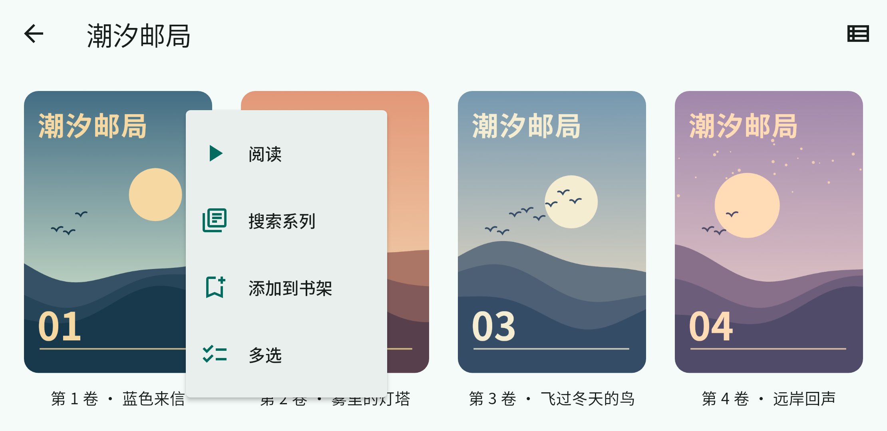
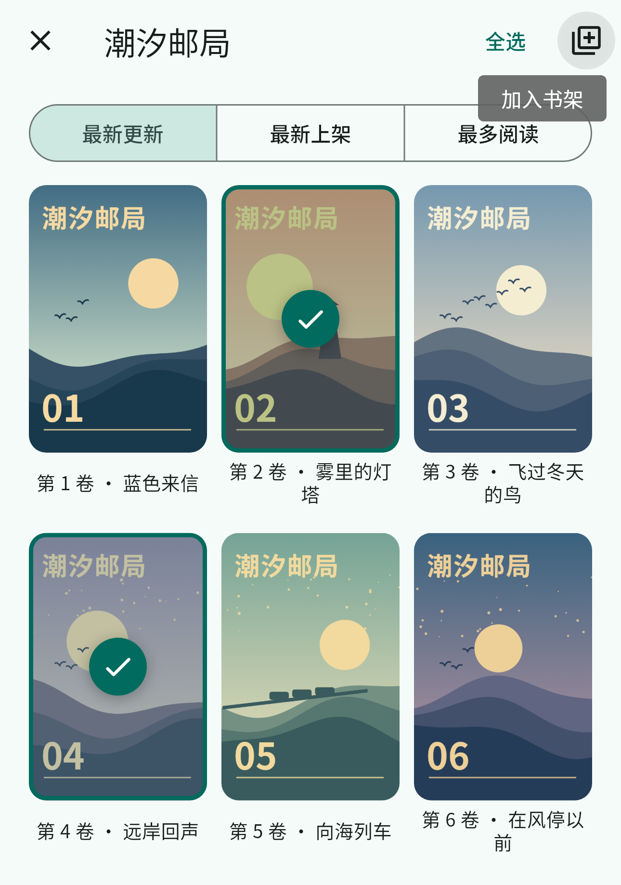
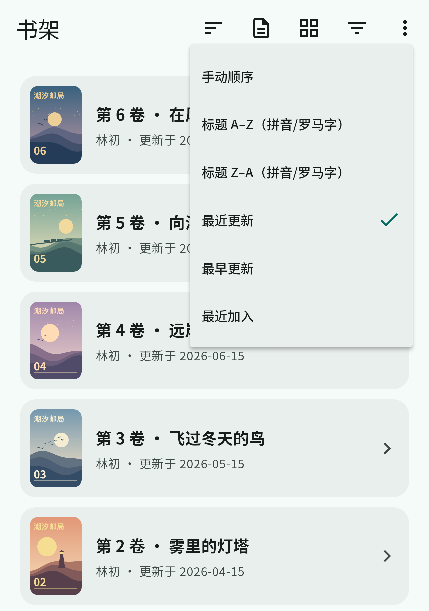
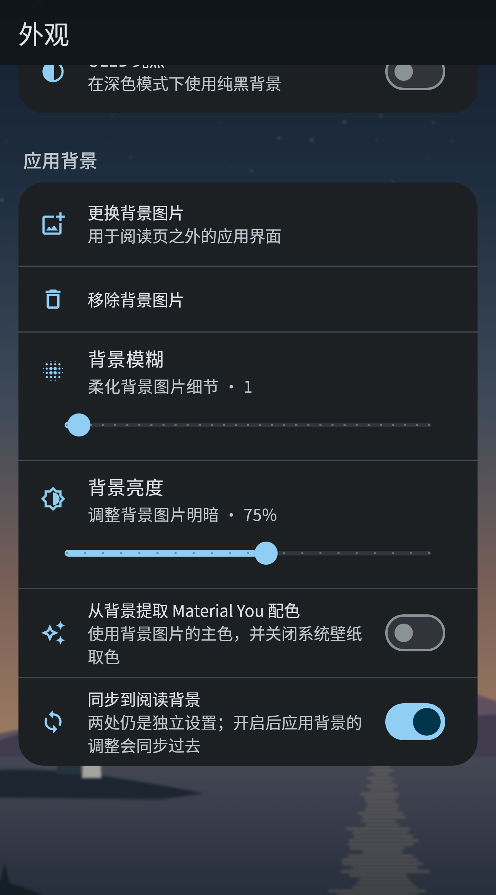
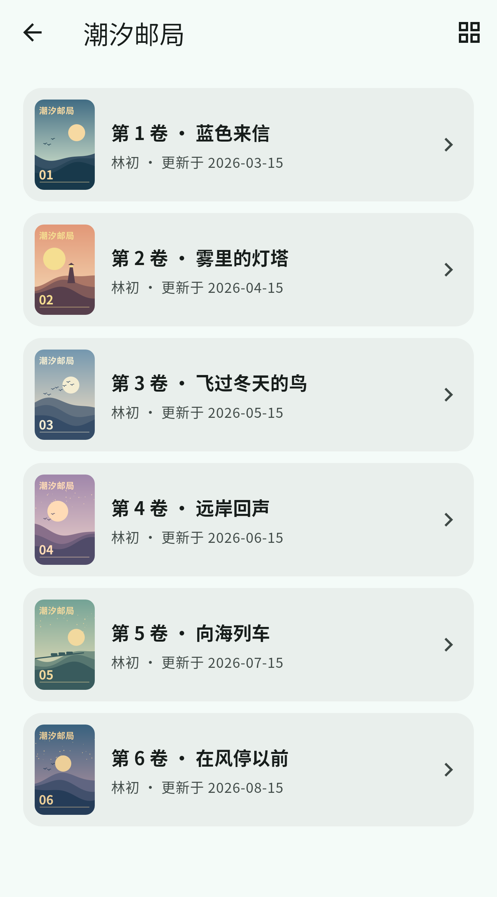
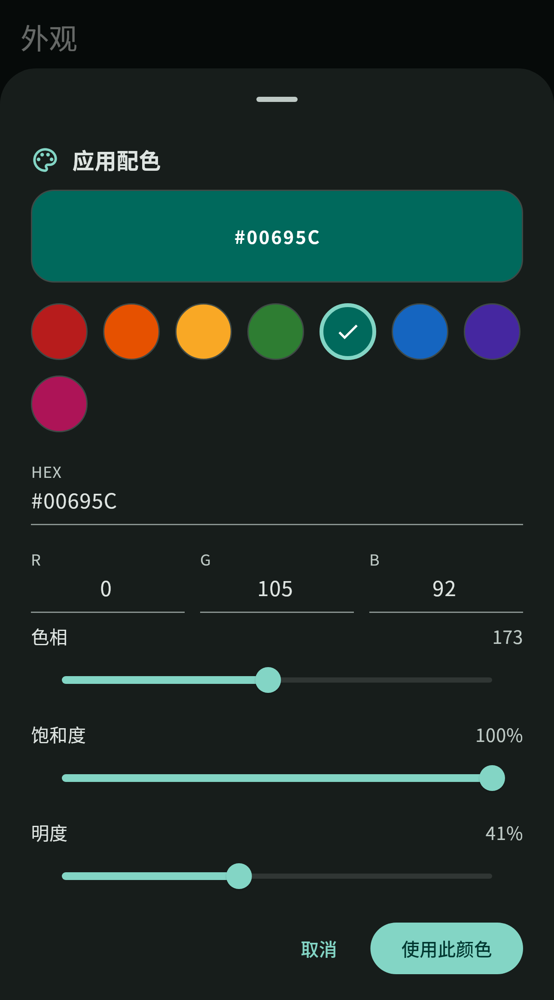
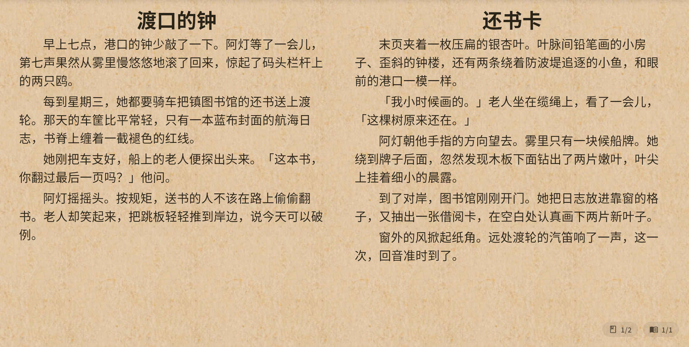

# 轻书架Plus

轻书架的小说与漫画客户端。手机上按系列整理书架，平板上摊开两页阅读，电脑上用键鼠选书、翻页。

**[下载最新版](https://github.com/Roroca-1/LightNovelShelf-Plus/releases/latest)** · [更新日志](CHANGELOG.md) · [问题与建议](https://github.com/Roroca-1/LightNovelShelf-Plus/issues)

## Plus 功能演示

以下是 Plus 在[官方客户端 v1.13.2](https://github.com/LightNovelShelf/Flutter/tree/6105cef68c7a09abcf8ec5e80cc5d107f2418462) 基础上增加的操作。截图中的书目为示例，点图可放大。

### 桌面右键选书

在 Windows 或 Linux 上右键一本书，即可直接阅读、查找同系列或管理书架。[桌面快捷键](docs/桌面快捷键.md)

### 整理书架

| 在发现页批量加书 | 给自己的书架排序 |
| --- | --- |
|  |  |
| 长按一本进入多选，勾选想看的卷册，一次加入书架。 | 按标题（拼音／罗马字）、更新时间或加入时间浏览，随时切回手动顺序。 |

### 把喜欢的图设为阅读背景

| 在「外观」调整图片 | 打开小说查看效果 |
| --- | --- |
|  |  |

应用和阅读器可以分别选图。想两处共用，就打开「同步到阅读背景」，亮度和模糊度也会一起同步。

查看系列分卷列表和主题色选择器

| 在书架按系列找书 | 自定义应用主题色 |
| --- | --- |
|  |  |

在书架点开系列就能按卷选书。应用配色支持自选颜色，也能从背景图提取。

双页阅读与其他功能

- **阅读**　横屏足够宽时，小说和漫画都能双页并排，漫画封面可独占一页。小说翻页时按页跳转，滚动时按本章百分比定位，滑到章尾再继续滑即可换章。插图可放大，有原图时可切换查看。
- **书架与历史**　小说和漫画可同步到账号书架，用文件夹收纳。书架与历史会记住网格或列表偏好；书架还支持按类型筛选、批量移出。
- **平板与桌面**　宽屏可用侧边导航和左右分栏；Linux、Windows 支持连续多选和键盘翻页。
- **外观与缓存**　可单独设置阅读文字颜色。Android 支持系统壁纸配色和 OLED 纯黑。首页、书架和历史优先展示已有缓存，可分别清理图片和章节字体缓存。
- **账号与更新**　支持自动签到和启动时检查更新。Android 可在应用内下载安装包，桌面与 iOS 可从更新提示打开下载页。设置页可恢复默认偏好。

## 下载与安装

| 平台 | 选择的安装包 |
| --- | --- |
| Android ARM64 | `arm64-v8a.apk`，可与官方版共存 |
| Windows x86_64 | `setup.exe` 安装程序 |
| Linux x86_64 | AppImage、Debian `.deb` 或 Arch `.pkg.tar.zst` |
| iOS | 未签名 `.ipa`，真机安装前需自行签名 |

Linux 上注册和重置密码需要在网页完成人机验证。自行编译、iOS 签名与凭据存储说明见[本地构建指南](docs/本地构建.md)。

## 致谢与支持

Plus 基于[轻书架官方 Flutter 客户端](https://github.com/LightNovelShelf/Flutter)继续开发。感谢上游贡献者、原作 [Novella](https://github.com/celia-sh/Novella) 和提供界面交互思路的 [Kanscape](https://github.com/Kanscape)。

赞助轻书架网站

[爱发电](https://www.ifdian.net/a/wuyu8512)

